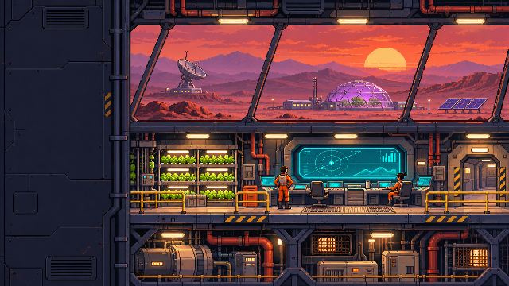
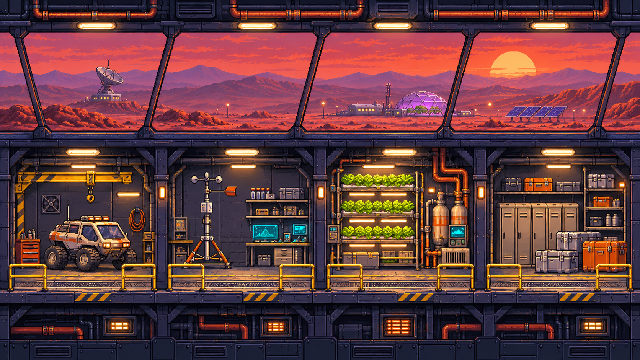
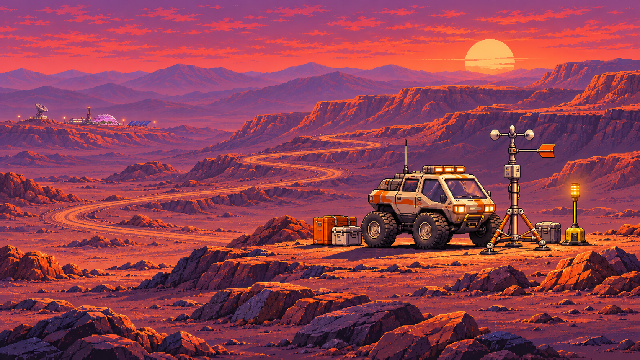

# Mars Station Program

A pixel-art Mars survival and mission-planning game built in Estella for NASA Space Apps. Manage your station crew, pack the rover, ride out dust and solar storms, and bring your field team and science data home before the deadline.



## Playable Missions

- **Tharsis Training Run (Tutorial)**: A guided 9-Sol mission with **ARIES**, our robot coach, who highlights each button step by step for younger players.
- **Tharsis Ridge Weather Survey (Easy)**: Record 48 hours of weather data at Site A by Sol 20 while riding out regional dust storms.
- **Radiation Detective (Medium)**: Drive the RAD detector to Hawksbill Gap, record 72 hours of readings by Sol 20, and protect your crew through a solar particle storm.
- **Ice Hunter (Hard)**: Travel to Jezero Crater Rim in `-70°C` to `-90°C` cold and drill 48 hours of ice cores by Sol 22.

| Station Operations | Rover Survey Site |
| :---: | :---: |
|  |  |

## Key Features

- **Kid-Friendly Controls**: Clear resource icons, `Lock lead` two-step task assignment, an End Sol safety check that warns before leaving tasks empty or running low on supplies, and a clickable **Next step** helper.
- **Animated End-of-Sol Report**: Visual crew cards showing each astronaut's portrait, health, morale, and animated progress bars for completed, partial, resting, or rover work.
- **First-Time ARIES Coach**: Highlights the exact next button to press from the main menu through the full training run (`How to Play` restarts it anytime).
- **Dynamic Events & Live A.R.I.E.S.**: 10 unique landing events, 36 randomized station and rover events, and optional live Gemini A.R.I.E.S. briefings and procedure brainstorming.

## Windows Playtest

1. Install [Estella Editor 0.104.1](https://github.com/esengine/estella/releases/tag/v0.104.1) and [Node.js 24 LTS with npm](https://nodejs.org/en/download).
2. Open PowerShell in the folder that contains `project.esproject`:

   ```powershell
   npm.cmd ci
   npm.cmd run verify
   ```

3. In Estella, use **Open Project** to select this folder, open `assets/scenes/main.esscene`, and press **F5**.
4. To play the Web export, choose **Build -> Package Project -> Web** and set the output directory to `dist/web`. After packaging, run `npm.cmd run playtest` and visit [http://127.0.0.1:4173/](http://127.0.0.1:4173/).

### Live Gemini A.R.I.E.S. (Web Export & Estella Editor)

Set `GEMINI_API_KEY` in an untracked `.env` beside `package.json`, then run:

```powershell
npm.cmd run playtest
```

The local Node server holds the key and exposes `/api/gemini-plan` on `http://127.0.0.1:4173`. Even if you have not exported `dist/web` yet, `playtest.mjs` runs in API bridge mode so your Estella Editor **F5** preview connects to live Gemini automatically. Restart `npm.cmd run playtest` after editing `.env`. Set `GEMINI_MODEL` to override the default model; see [docs/DEPLOY.md](docs/DEPLOY.md) for production deployment settings.

- Open **A.R.I.E.S.** from the station for live advice, or click **Discuss procedure** on a work order to brainstorm custom solutions.
- The A.R.I.E.S. badge shows **API configured**, **API online** after a valid response, or **Local fallback** when running offline with the built-in event library.

## Gameplay Flow

- **Crew & Upgrades**: Pick four crew members before launch (or via **Edit Crew** on the Launch Summary) and spend Research points on station upgrades.
- **Cargo Preparation**: Pack your mission instrument and supplies onto the 20-slot rover grid using **Auto Fill** or manual placement (`R` to rotate).
- **Daily Operations**: Resolve the morning briefing, schedule station tasks, lock a crew lead, manage Power, Food, Water, and Oxygen, and dispatch the rover with 2 astronauts when ready.

## Team Integration & Docs

See [Gameplay rules and UML](docs/GAMEPLAY-UML.md) for mission states, Sol resolution, and station/rover rules.

- `mars-outpost:pending-setup` accepts a team-provided `MissionSetupInput`.
- `mars-outpost:profile-v1` stores the player profile and research upgrades.
- `mars-outpost:last-result` holds the latest `MainLoopResult`.

See [art/README.md](art/README.md) and [CREDITS.md](CREDITS.md) for asset, font, audio, and NASA fact sources.
