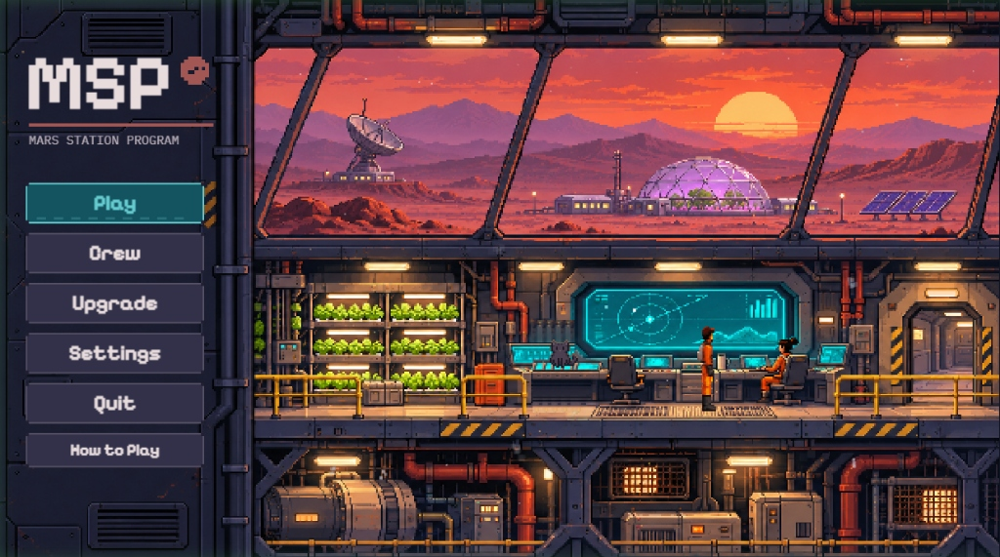
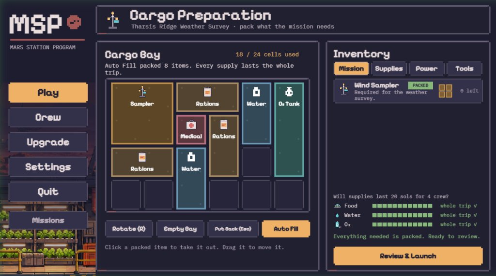
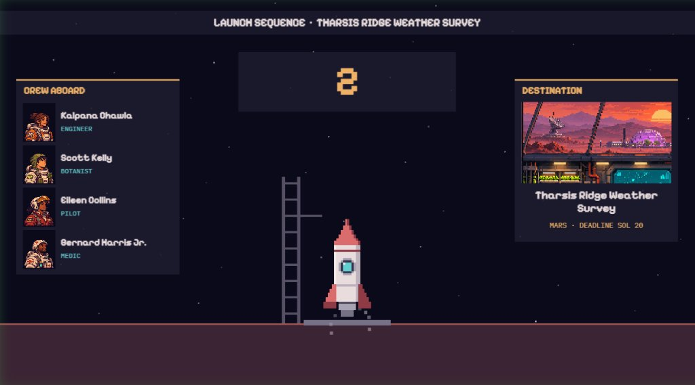
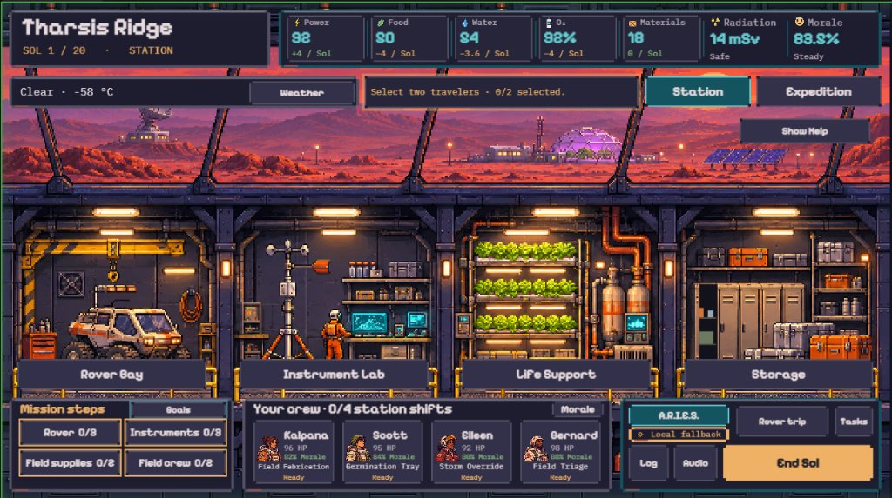

# Mars Station Program

A pixel-art Mars survival and mission-planning game built in Estella for NASA Space Apps. Manage your station crew, pack the rover's cargo bay, upgrade station systems, ride out dust and solar storms, and bring your field team and science data home before the deadline.



## Playable Missions

| Mission | Difficulty | Deadline | Field Objective | Conditions |
| :--- | :--- | :--- | :--- | :--- |
| **Tharsis Training Run** | Tutorial | Sol 9 | Guided practice run with ARIES | Mild weather; ARIES highlights every button step by step |
| **Tharsis Ridge Weather Survey** | Easy | Sol 20 | Record 48 hours of weather data at Site A | Clear to regional dust storms (`-58°C`) |
| **Radiation Detective** | Medium | Sol 20 | Drive the RAD Detector to Hawksbill Gap and record 72 hours | Solar particle storm window; higher radiation risk |
| **Ice Hunter** | Hard | Sol 22 | Drive the Ice Drill to Jezero Crater Rim and drill 48 hours of cores | Extreme `-70°C` to `-90°C` cold and heavy storm pressure |

## Gameplay Screenshots

| Crew Selection | Cargo Preparation |
| :---: | :---: |
|  |  |

| Launch Sequence | Station Operations |
| :---: | :---: |
|  |  |

## Game Systems

### 1. Crew Selection & Abilities

Before launch (or via **Edit Crew** on the Launch Summary), pick 4 astronauts from a 6-member NASA-inspired roster. Each crew member brings a role affinity (30% fewer supplies, 50% faster work, and 15% higher yield on matching tasks) plus an active signature ability:

- **Kalpana Chawla (Engineer, Field Fabrication)**: Turn 4 station Materials into a Repair Kit once per mission.
- **Scott Kelly (Botanist, Germination Tray)**: Plant a Seed Pod with 2 Water and harvest 18 Food two Sols later, once per mission.
- **Eileen Collins (Pilot, Storm Override)**: Spend 4 extra rover Power to drive through one storm Sol, once per mission.
- **Bernard Harris Jr. (Medic, Field Triage)**: Use a Medkit to restore a living crew member to at least 40 HP and 40 Morale and reset duty, once per mission.
- **Chiaki Mukai (Scientist, Double Shift)**: Lead two station jobs per Sol for 3 Sols, followed by 3 Sols of recovery.
- **Neil Armstrong (Captain, Read the Situation)**: Preview one briefing response each morning while the Captain is present.

### 2. Cargo Preparation System (6x4 Spatial Grid)

Your rover has a **24-cell Cargo Bay** (`6 columns x 4 rows`) that must hold your mission instrument alongside enough supplies for the trip:

- **Mission Instruments**: Pack the `Wind Sampler` (`2x2`, 4 cells) for Weather Survey, `RAD Detector` (`1x2`, 2 cells) for Radiation Detective, or `Ice Drill` (`1x3`, 3 cells) for Ice Hunter.
- **Survival & Support Cargo**: Choose from `Extra Rations` (`2x1`, +10 Food, +5 Morale), `Water Canister` (`1x2`, +14 Water), `Oxygen Tank` (`3x1`, +16 O₂), `Repair Kit` (L-shaped 3 cells, +12 O₂, +6 Power), `Battery Pack` (`2x1`, +22 Power), `Seed Pod` (`1x1`, +8 Food, +6 O₂), and `Medkit` (`1x1`, +15 HP, +6 Morale, -12 radiation).
- **Packing Controls & Trip Meters**: Drag items onto the grid, press `R` to rotate through 4 orientations, click packed items or press `Esc` to return them, or click **Auto Fill** to pack the required instrument and top up supplies automatically. Live Food, Water, and O₂ meters on the right verify whether your load lasts the full mission for 4 crew.

### 3. Upgrade System (4-Branch Skill Tree)

You start with **3 Research Points (RP)** and earn more by completing missions (including a one-time clear bonus on the Training Run). Spend RP across 4 branches, each with 6 nodes across 4 tiers (`3 / 5 / 7 / 10` RP). You can sell back and refund all upgrades at any time between missions.

- **Infrastructure**: Boosts solar output (`Efficient Inverters`, `Sun Tracking`), cuts daily power drain (`Power Balancing`, `Heat Recovery`), and unlocks **Battery Bank** (store/return 12 station Power once per Sol) and **Habitat Microgrid** (run indoor Life Support orders during full storm shelter).
- **Survival**: Cuts food and water consumption (`Algae Nutrient Loop`, `Greywater Reclaimer`, `Condenser`), boosts plant yields (`Grow Trays`), and unlocks **Emergency Electrolysis** (trade 4 Water and 3 Power for 12 O₂ once per Sol) and **Emergency Stores** (automatically releases +8 Food, +8 Water, and +12 O₂ the first time upkeep depletes any of them).
- **Operations**: Increases rover yields (`Survey Routes`, `Rover Racks`), speeds up crewed tasks (`Dispatch Automation`), discounts A.R.I.E.S. plans (`Planning Cache`), and unlocks **Weather Relay** (reveals exact storm dates from Sol 1) and **Autonomous Recorder** (preserves partial survey data through one lost sampling Sol).
- **Crew**: Slows morale decay (`Habitation Quarters`), adds radiation shielding (`Dosimeter Network`, `Storm Shelter`), speeds up tasks (`Shift Scheduling`), and unlocks **Cross-Training** (spend 4 Power to train one crew member in a second role) and **Protected Rotation** (spend 2 Food to grant rest Morale while working).

### 4. Daily Station & Rover Loop

Each Sol moves through a structured command loop across two views (**Station** and **Expedition**):

- **Morning Briefing & Events**: Resolve the daily briefing before planning. Runs pull from 10 unique Sol 1 landing events and 36 randomized station and rover events, scaled by weather and mission stage.
- **Station Planning**: Schedule tasks across `Rover Bay`, `Instrument Lab`, `Life Support`, and `Storage` using two-step `Lock lead` assignment. Balance `Power`, `Food`, `Water`, `O₂`, `Materials`, `Radiation`, and `Morale`, or trigger crew abilities and unlocked station upgrades.
- **Rover Expeditions**: Assign 2 travelers (`Select two travelers`) and launch the rover to the field site to deploy instruments, collect science hours, and return safely before the Sol deadline.
- **End Sol Safety & Animated Reports**: An End Sol safety check warns you before advancing if tasks are left unscheduled or critical supplies are running low. After resolving the Sol, animated crew report cards display each astronaut's portrait, HP, morale, and progress bar for completed, partial, resting, or rover work.

### 5. ARIES Coach & Kid-Friendly Controls

- **First-Time Interactive Tutorial**: **ARIES** highlights the exact next button to press from the main menu through the full 9-Sol Training Run. Click **How to Play** on the main menu to restart it anytime.
- **In-Game Helper**: A clickable **Next step** guide and clear plain-language crew ability labels (`Best time:` hints and `Show Help`) keep younger players oriented without clutter.

## Windows Playtest

1. Install [Estella Editor 0.104.1](https://github.com/esengine/estella/releases/tag/v0.104.1) and [Node.js 24 LTS with npm](https://nodejs.org/en/download).
2. Open PowerShell in the folder that contains `project.esproject`:

   ```powershell
   npm.cmd ci
   npm.cmd run verify
   ```

3. In Estella, use **Open Project** to select this folder, open `assets/scenes/main.esscene`, and press **F5**.
4. To play the Web export, choose **Build -> Package Project -> Web** and set the output directory to `dist/web`. After packaging, run `npm.cmd run playtest` and visit [http://127.0.0.1:4173/](http://127.0.0.1:4173/).

### Live Gemini A.R.I.E.S. (Web Export & Estella Editor)

Set `GEMINI_API_KEY` in an untracked `.env` beside `package.json`, then run:

```powershell
npm.cmd run playtest
```

The local Node server holds the key and exposes `/api/gemini-plan` on `http://127.0.0.1:4173`. Even if you have not exported `dist/web` yet, `playtest.mjs` runs in API bridge mode so your Estella Editor **F5** preview connects to live Gemini automatically. Restart `npm.cmd run playtest` after editing `.env`. Set `GEMINI_MODEL` to override the default model; see [docs/DEPLOY.md](docs/DEPLOY.md) for production deployment settings.

- Open **A.R.I.E.S.** from the station for live advice, or click **Discuss procedure** on a work order to brainstorm custom solutions.
- The A.R.I.E.S. badge shows **API configured**, **API online** after a valid response, or **Local fallback** when running offline with the built-in event library.

## Team Integration & Docs

See [Gameplay rules and UML](docs/GAMEPLAY-UML.md) for mission states, Sol resolution, and station/rover rules.

- `mars-outpost:pending-setup` accepts a team-provided `MissionSetupInput`.
- `mars-outpost:profile-v1` stores the player profile and research upgrades.
- `mars-outpost:last-result` holds the latest `MainLoopResult`.

See [art/README.md](art/README.md) and [CREDITS.md](CREDITS.md) for asset, font, audio, and NASA fact sources.
