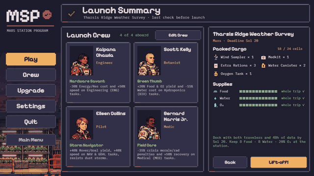
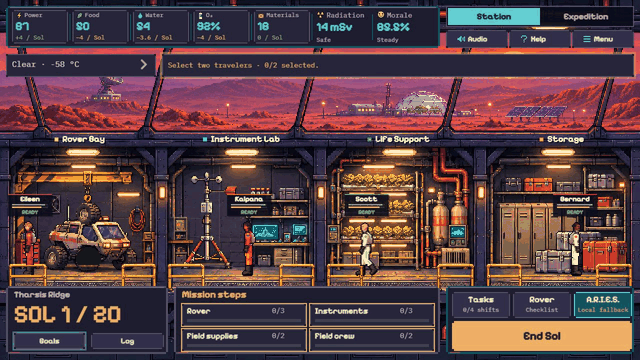

<h1 align="center">Mars Station Program</h1>

  

<h3 align="center">👉 <a href="https://msp.amerai.top/">msp.amerai.top</a> · plays in your browser, nothing to install</h3>

A pixel-art Mars survival game for NASA Space Apps. Pick a crew, pack the rover, survive the storms, and bring the science home before the deadline.

## Missions

| Mission | Difficulty | Goal |
| :--- | :--- | :--- |
| **Tharsis Training Run** | Tutorial | Learn the game with ARIES in 5 Sols |
| **Tharsis Ridge Weather Survey** | Easy | Record 48h of weather data |
| **Radiation Detective** | Medium | Record 72h of radiation during a solar storm |
| **Ice Hunter** | Hard | Drill ice cores at Jezero Crater in deep cold |

<table>
<tr><th width="50%">Mission Selection</th><th width="50%">Launch to Mars</th></tr>
<tr><td width="50%"></td><td width="50%"></td></tr>
</table>

## How It Plays

**1. Pick your crew.** Choose 4 of 6 real NASA astronauts, each with their own skill.

<table>
<tr><th width="50%">Edit Crew</th><th width="50%">Launch Summary</th></tr>
<tr><td width="50%"></td><td width="50%"></td></tr>
</table>

**2. Pack the rover.** Fit the instrument, food, water and oxygen into a 6×4 cargo grid.

**3. Run the station.** Each Sol, handle the morning news, assign crew to jobs, and send two of them out in the rover.

<table>
<tr><th width="50%">Morning Briefing</th><th width="50%">End of Sol Report</th></tr>
<tr><td width="50%"></td><td width="50%"></td></tr>
</table>

**4. Upgrade.** Spend research points on power, survival, operations and crew upgrades.

**ARIES**, the station robot, guides new players step by step and can give live advice through Gemini.

## Run It Locally

The easiest way to play is **[msp.amerai.top](https://msp.amerai.top/)**. To run it yourself:

1. Install [Estella Editor 0.104.1](https://github.com/esengine/estella/releases/tag/v0.104.1) and [Node.js 24](https://nodejs.org/en/download).
2. In this folder, run `npm.cmd ci`.
3. Open the folder in Estella, open `assets/scenes/main.esscene`, and press **F5**.

Web build and live Gemini setup: [docs/DEPLOY.md](docs/DEPLOY.md). Game rules: [docs/GAMEPLAY-UML.md](docs/GAMEPLAY-UML.md). Credits: [CREDITS.md](CREDITS.md).
