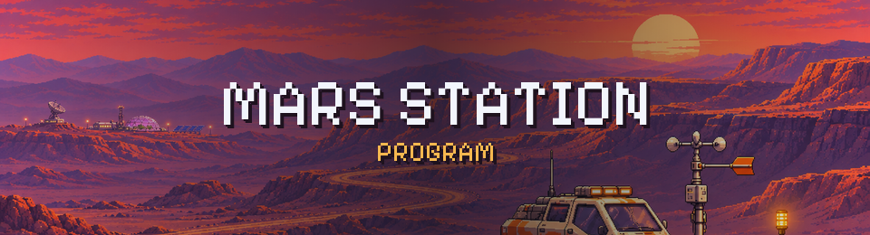
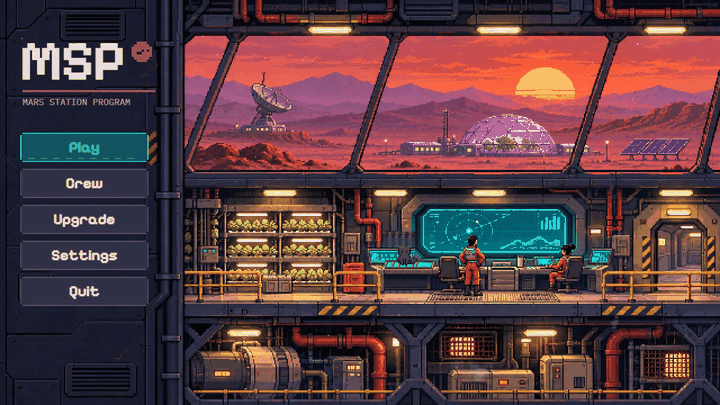
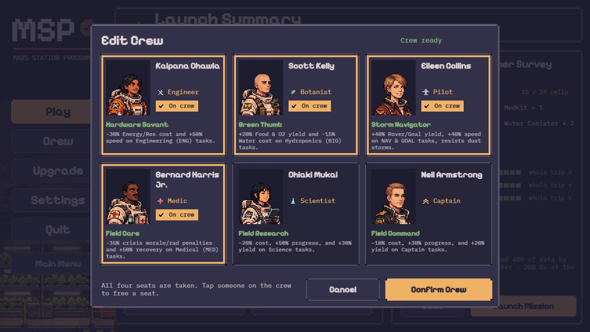
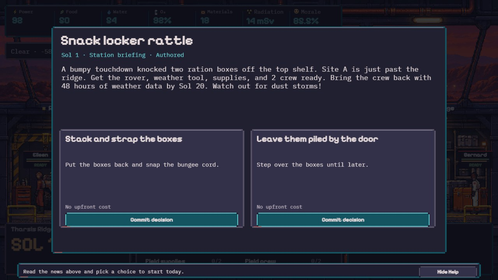

  
  &nbsp;
  

  
  
  

A pixel-art Mars survival game for NASA Space Apps. Pick a crew, pack the rover, survive the storms, and bring the science home before the deadline.

## Missions

<table>
<tr><th>Mission</th><th>Difficulty</th><th>Goal</th></tr>
<tr><td><b>Tharsis Training Run</b></td><td>Tutorial</td><td>Learn the game with ARIES in 5 Sols</td></tr>
<tr><td><b>Tharsis Ridge Weather Survey</b></td><td>Easy</td><td>Record 48h of weather data</td></tr>
<tr><td><b>Radiation Detective</b></td><td>Medium</td><td>Record 72h of radiation during a solar storm</td></tr>
<tr><td><b>Ice Hunter</b></td><td>Hard</td><td>Drill ice cores at Jezero Crater in deep cold</td></tr>
</table>

## How It Plays

**1. Pick your crew.** Choose 4 of 6 real NASA astronauts, each with their own skill.

**2. Pack the rover.** Fit the instrument, food, water and oxygen into a 6×4 cargo grid.

**3. Run the station.** Each Sol, handle the morning news, assign crew to jobs, and send two of them out in the rover.

**4. Upgrade.** Spend research points on power, survival, operations and crew upgrades.

**ARIES**, the station robot, guides new players step by step and can give live advice through Gemini.

## Run It Locally

1. Install [Estella Editor 0.104.1](https://github.com/esengine/estella/releases/tag/v0.104.1) and [Node.js 24](https://nodejs.org/en/download).
2. In this folder, run `npm.cmd ci`.
3. Open the folder in Estella, open `assets/scenes/main.esscene`, and press **F5**.

Web build and live Gemini setup: [docs/DEPLOY.md](docs/DEPLOY.md). Game rules: [docs/GAMEPLAY-UML.md](docs/GAMEPLAY-UML.md). Credits: [CREDITS.md](CREDITS.md).
