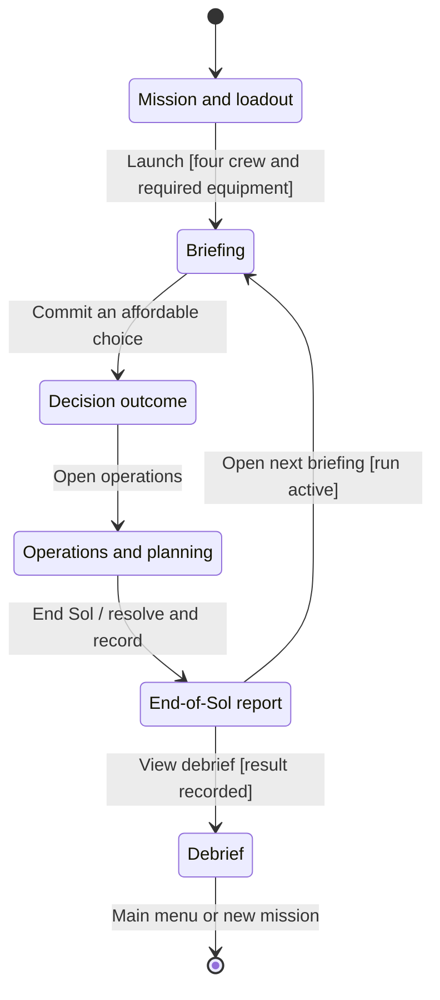
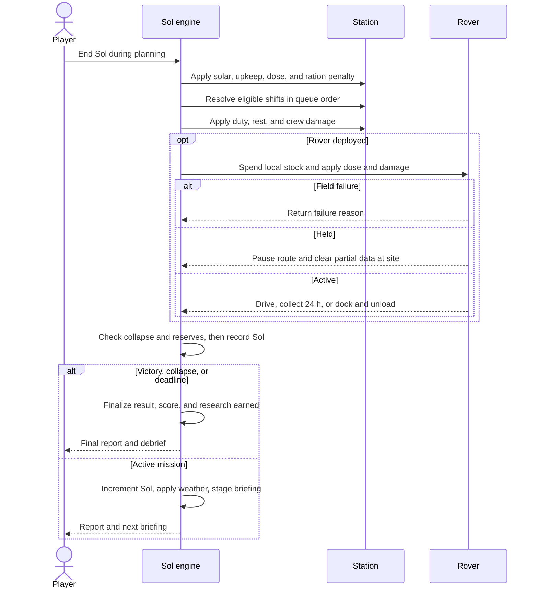
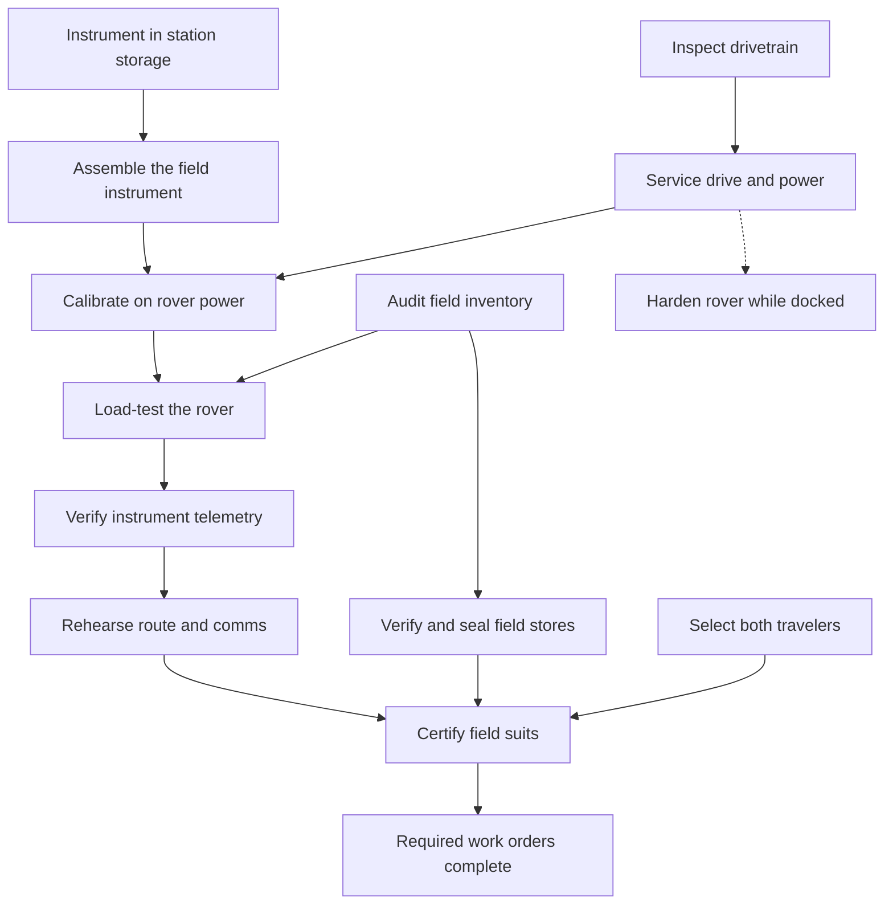
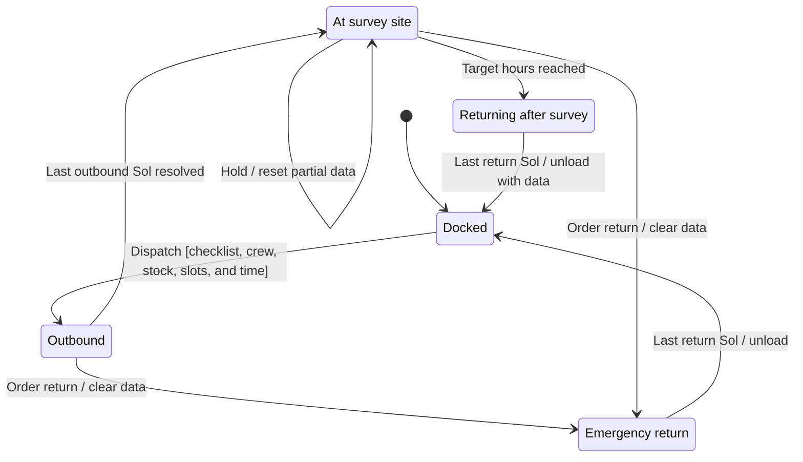

# MSP gameplay rules

## Mission state machine

| Playable mission | Site and cargo instrument | Drive per leg, Pilot / backup | Consecutive data | Deadline | Three-Sol hazard can start on |
| --- | --- | --- | --- | --- | --- |
| Tharsis Ridge Weather Survey · Easy | Site A · Wind Sampler | 1 / 2 Sols | 48 h | Sol 16 | Sol 8, 9, or 10 · dust |
| Radiation Detective · Medium | Hawksbill Gap · RAD Detector | 1 / 2 Sols | 72 h | Sol 16 | Sol 7, 8, or 9 · solar |
| Ice Hunter · Hard | Crater rim · Ice Drill | 2 / 3 Sols | 48 h | Sol 18 | Sol 9, 10, or 11 · dust |

- Launch requires four distinct crew and the mission's required equipment. The built-in roster offers an engineer, botanist, pilot, medic, scientist, and captain. The launch packer uses a 6 × 4 grid with nonoverlapping rotated footprints and per-item stock limits.
- A prepared team manifest can supply the crew, cargo, resources, and conditions. A manifest without an expedition profile uses Tharsis. Launch consumes the pending setup. Shadow Ice, Breathe Easy, and Space Garden are marked Coming soon.
- Built-in starting stock is 82 Power, 44 Food, 48 Water, 88% O₂, and 14 Materials. Starting radiation is 14 mSv. The expedition supplies the active temperature and weather.

Code · [Mission setup and launch](../src/data/missions.ts) · [Expedition profiles](../src/data/expeditions.ts) · [Mission picker](../src/data/nasaMissions.ts) · [Cargo packing](../src/data/cargo.ts) · [Run phases](../src/simulation/solEngine.ts)

## End Sol sequence

- **Victory** requires docking with complete data and meeting the reserve floor. Built-in floors are 10 Food, 10 Water, and 25% station O₂. The check includes completed station shifts and resources unloaded that Sol. If reserves are below the floor, station operations can continue until the deadline.
- **Defeat** occurs on collapse or when the last Sol resolves without victory. The engine uses the earlier of the target Sol and goal deadline. Docking on that final Sol counts.
- **Station collapse** occurs at 100 mSv, zero station O₂, zero living-crew average Morale, or all station crew incapacitated. **Field failure** occurs at 100 mSv, zero rover O₂, either traveler reaching zero health, or zero field average Morale. Collapse takes precedence over completion.
- Station and rover each hold their own resource pool, cargo, and conditions. The rover inherits station radiation when dispatched. Crew health, stamina, Morale, and duty streak travel with the member. Resource updates round to tenths and floor at zero. Power is capped at 120 and O₂ at 100 in each pool.

Code · [Sol resolution and results](../src/simulation/solEngine.ts) · [Expedition resolution](../src/simulation/tharsis.ts) · [Resource arithmetic](../src/simulation/stateOps.ts)

## Work orders and dispatch checks

Every incoming arrow is a requirement for the next check. Hardening is optional.

- Schedule or revise during planning. An accepted order needs a living station lead. Assigning a lead takes them off their previous order. Different leads can run parallel shifts. Changing the field pair cancels or invalidates suit certification. Dispatch clears those two crew members' station assignments.
- Each staffed order checks equipment, staffing, weather, heating, radiation, and affordability before paying for a shift. Progress and pace use tenths of a shift. Output and completed checklist marks arrive on completion. Production and triage orders can repeat.
- A listed specialist, a lead using Parallel, or any lead on a one-shift base order starts at pace 1. Other leads start at 0.8. A category-matched perk multiplies that pace. Then add the upgrade speed bonus and apply the Morale pace multiplier. The same perk can reduce costs and boost output. The Operations cost multiplier applies to the quote. BIO and NAV output use their category multipliers.
- Exterior orders wait during storms. A hardened rover allows its load test through the storm restriction. At 75 mSv or more, exterior work holds regardless of weather. Full shelter during a storm and a heating shortfall each hold station orders except `air` and `triage`, which still need to be funded. Queued rover hardening waits until the rover docks.
- Optional support orders restore Power (solar), O₂ (air), Water (reclaimer), Food and O₂ (hydroponics), or Materials (spares). Triage restores 10 base health per living station member and reduces dose by 60% of its perk-adjusted recovery amount. Shielding improves Essential and Full shelter.

| Technique | Shift changes | Cost changes per shift, before modifiers |
| --- | --- | --- |
| Specialist | −1 required shift, eligible specialist required | +1 Power |
| Parallel | −1 required shift, standard pace for backup leads | +2 Power, +1 Materials |
| Reuse spares | Same shift count | +1 Power, −1 Materials |
| Pulse test | +1 required shift | −2 Power, +1 Materials |
| Closed cycle | Same shift count | +1 Power, −1 Water when water is required |

Techniques must be available for the order. A procedure may have up to two distinct techniques. Choose one of Specialist and Parallel. Adjusted shifts floor at one and adjusted costs at zero. A backup lead adds 1 Power before discounts.

Code · [Orders and prerequisites](../src/data/tharsisOrders.ts) · [Scheduling, costs, and holds](../src/simulation/tharsisWork.ts)

## Rover state machine

- **Dispatch** requires planning, a docked rover, an incomplete field objective, two certified travelers at ≥40 HP and ≥20% Morale, and the complete work-order checklist. The clean trip needs `2 × drive Sols per leg + survey hours ÷ 24`. Latest clean departure is the goal deadline minus that duration plus one.
- **Rover load** requires one mission instrument, available integer bulk and cargo quantities, clean-trip upkeep plus 1 extra O₂, and at most 20 slots. Bulk units per slot are 8 Power, 4 Food, 4 Water, 6 O₂, and 4 Materials. Round each bulk pool up to whole slots, then add packed items' footprint areas. Cargo potential counts at validation. Use packed items at their location to add the supplies.
- **Storm reserve** advises extra Power and O₂ for a hardened rover. It takes the worst feasible storm overlap before the warning Sol, then uses the run's storm dates. The dispatch requirement uses the clean trip.
- **Progress** advances once per funded and eligible Sol. Arrival and first collection occur on separate Sols. The return leg starts after the final 24-hour sample. Any site hold resets partial survey progress. An emergency return needs the distance already covered, with a minimum of one drive Sol. Docking returns surviving travelers and unused supplies to station operations.
- **Holds** include an unfunded upkeep bill, standard-rover storm shelter, forced rest below 20% Morale at the start of resolution, planned rest, dangerous radiation while sampling, a briefing interruption, any traveler below 40 HP after damage, and a missing instrument at the site. Held Sols still spend upkeep and apply dose. Planned rest and briefing interruptions clear after one resolved Sol.
- **Docking projection** steps through visible weather, storm shelter, the current rest or reset, and radiation through each leg. A radiation hold restarts partial sampling. A projected dose of 100 mSv produces a critical exposure warning. Supplies, treatment, and future decisions can change the projection.

Code · [Manifest, weather reserve, route, and holds](../src/simulation/tharsis.ts) · [Rover checklist and storage controls](../src/ui/tharsisManifest.ts)

## Upkeep, weather, and crew

The storm starts on the profile's first possible Sol plus `(seed as an unsigned integer) % 3` for the built-in missions. Storm Sols run consecutively. A dust hazard has a Dust Haze Sol immediately before onset. Radiation Detective's lead-in still displays Clear.

| Profile | Clear °C | Warning °C | Storm °C | Hazard exposure multiplier |
| --- | ---: | ---: | ---: | ---: |
| Tharsis | −58 | −64 | −76 | 1.00 |
| Radiation | −55 | −55 | −57 | 1.35 |
| Ice | −70 | −78 | −90 | 1.00 |

| Weather | Station solar | Station filters, Power / O₂ | Rover filters, Power / O₂ |
| --- | ---: | ---: | ---: |
| Clear | 8 | 0 / 0 | 0 / 0 |
| Dust Haze | 4 | 1 / 1 | 0 / 1 |
| Dust storm, Sol 1 | 2 | 3 / 2 | 2 / 2 if hardened, 0 / 2 if standard |
| Dust storm, Sol 2 | 0 | 5 / 3 | 3 / 3 if hardened, 0 / 3 if standard |
| Dust storm, Sol 3 | 3 | 3 / 2 | 2 / 2 if hardened, 0 / 2 if standard |
| Solar flare | 8 | 0 / 0 | 0 / 0, plus 1 Power for hardened rover monitoring |

- **Station baseline per Sol** uses 4 Power, 2 O₂ plus 0.5 per living station member, 1 Food per living member (0.5 on half rations), and 0.9 Water per living member. Dust storms also use 7 Power with shelter Off, 2 in Essential, or 0 in Full. Add heating and filter draws, then apply the relevant upgrade modifiers. Half rations cost 2.5 base Morale per station member. Auxiliary solar salvage multiplies passive generation by 0.65.
- **Rover baseline per Sol** uses 2 Food, 2 Water, 3 O₂, and 4 Power. The base Power draw falls to 2 for planned or forced Morale rest or standard-rover storm shelter. Add heating, filtration, and monitoring from the weather. Station rations do not change rover consumption.
- **Heating** costs one Power per started 10 °C below −65 °C. A hardened rover pays the clear-weather heating cost plus half the extra heating, rounded up. A heating shortfall occurs when heating is needed and available Power cannot fund total upkeep, including station solar where applicable.
- **Radiation** gains use the base values below, multiplied by the storm Sol factors `1.0, 1.4, 0.9`, the hazard exposure multiplier, and `1 − radiation shielding`. Outside the storm, station dose drops 3 mSv per Sol and rover dose drops 2. Exposure is clamped to 0–100. Station triage can reduce the dose before later shifts and crew damage resolve.

| Location and protection | Base storm dose in mSv |
| --- | ---: |
| Station Off | 25 |
| Station Essential, standard / shielded | 12 / 4 |
| Station Full, standard / shielded | 5 / 2 |
| Standard rover, dust / solar | 22 / 25 |
| Hardened rover | 5 |

| Resulting dose | HP lost per Sol | Base Morale lost per Sol | Operational effect |
| --- | ---: | ---: | --- |
| Below 30 | 0 | 0 | Routine |
| 30 to below 50 | 2 | 3 | Elevated |
| 50 to below 75 | 5 | 7 | High |
| 75 to below 100 | 12 | 12 | Exterior shifts and site sampling hold |
| 100 | 12 | 12 | Critical exposure |

- **Other damage** adds 14 HP and 10 base Morale loss for a heating shortfall, or 10 HP and 6 base Morale loss for a life-support shortage. Station shortages use empty Food, Water, or O₂ after shifts. Rover shortages use an unfunded upkeep bill or depleted O₂. Empty station batteries during a storm also cost 8 Morale.
- **Duty and rest** cost 1, 3.5, 6, then 8 base Morale on successive working Sols. Morale decay upgrades scale duty, ration, and environmental losses. An off-duty Sol restores up to 12 Morale and clears the streak. An active Sol costs 7 stamina, with a floor of 20. Rest restores up to 12 stamina. Area Morale is the average of the living crew at that location.
- **Pace and fitness** use individual Morale. Below 60%, station pace is ×0.75. Below 35% it is ×0.5. Below 20%, either field member forces a rest Sol for the pair. Health zero incapacitates a crew member. Supplies and triage can heal living crew.

Code · [Daily budgets and crew effects](../src/simulation/tharsis.ts) · [Heating, dose, and Morale thresholds](../src/simulation/tharsisConditions.ts)

## Cargo and briefings

| Item | Footprint cells | Launch packer stock | Use one |
| --- | ---: | ---: | --- |
| Wind Sampler / RAD Detector / Ice Drill | 4 / 2 / 3 | 1 each | Reserved for the expedition survey |
| Repair Kit | 3 | 2 | +12 O₂ and +6 Power |
| Battery Pack | 2 | 2 | +22 Power |
| Medkit | 1 | 2 | +15 HP and +6 Morale per living member, −12 mSv locally |
| Seed Pod | 1 | 2 | +8 Food and +6 O₂ |
| Extra Rations | 2 | 3 | +10 Food and +5 Morale per living member |
| Water Canister | 2 | 3 | +14 Water |
| Oxygen Tank | 3 | 2 | +16 O₂ |

- **Planning inventory** can consume one item at a time at the station or rover. Briefing commitments use the location's actual stock. A cargo commitment removes that item and applies the listed choice effects. Use one applies the cargo effects in the table.
- **Briefing source** uses Mission Control on Sol 1 and for the storm. Local briefings come from a seeded deck. A validated live briefing can commit during the previous Sol's open report. An authored storm notice remains visible alongside a live incident. Opening the next briefing commits the available version. A decision resolves once and then reveals its effects.
- **Choice economy** has a free commitment or a commitment of 2 Power, 2 Water, or 1 Materials. Base losses are 3 Power, 2 Water, 2 O₂, 2 Food, or 1 Materials. Positive effects can add 2 Power, Water, or O₂ in permitted systems. Other effects adjust Morale by ±2, add 3 mSv, or interrupt a site survey. Severity is 1 or 2, with interruptions limited to severity 1 and their permitted field systems. Morale losses and exposure use the respective crew modifiers.
- **Live validation** requires two or three distinct choices, a system at the current location, permitted commitment and effect IDs, available event cargo, and at least one cost-free choice without a negative effect. Recently used systems are excluded. Displayed title, observation, action, detail, and result limits are 52, 310, 48, 126, and 150 characters after name substitution.
- **A.R.I.E.S. procedures** require player acceptance and a staffed shift. A draft can revise an unstarted order. A custom task takes 1–4 base shifts and uses 1–3 resource types at a time. It outputs 1–2 different resource types on completion. Per-shift input caps in Power / Food / Water / O₂ / Materials order are 8 / 4 / 4 / 5 / 4. Output ceilings per base shift are 12 / 9 / 10 / 12 / 4, with a combined normalized output cap of 125%. Custom tasks use their own IDs and sit outside the dispatch checklist.
- **Salvage** yields Materials only, from a minimum of 4 up to the equipment cap. Once completed, hydroponics salvage disables harvests (cap 10), auxiliary solar salvage cuts passive generation by 35% (cap 12), and reclaimer salvage disables potable-water jobs (cap 10).

Code · [Cargo definitions](../src/data/cargo.ts) · [Briefing rules](../src/simulation/tharsisEvents.ts) · [Custom tasks](../src/simulation/tharsisCustom.ts) · [Salvage](../src/data/tharsisEquipment.ts)

## Progression

- A fresh profile starts with 3 research points. Infrastructure, Survival, Operations, and Crew each have a Tier 1 root, two Tier 2 branches, two matching Tier 3 nodes, and a Tier 4 node requiring both Tier 3 nodes. Purchases debit 3 / 5 / 7 / 10 points by tier and require the listed prerequisites. Reset refunds the full cost of owned upgrades.
- Upgrades carry into new missions. Consumption, output, cost, and Morale decay factors multiply. Task speed bonuses and radiation shielding add. Shielding caps at 75%. The upgrade catalog defines each effect.
- Each debrief scores 40 per Sol reached, 60 per completed task, and 35 per specialist shift. Add rounded remaining resource value with weights Power 1, Food 2, Water 2, O₂ 1, Materials 3. Add 400 for the completed goal and 500 for victory, then floor the score at zero. Research is `max(2, round(score ÷ 180))`, awarded once per run. The profile and last result are saved locally.

Code · [Roster and upgrade catalog](../src/contracts/gameContract.ts) · [Profile and research](../src/data/profile.ts) · [Score and debrief](../src/simulation/solEngine.ts)
